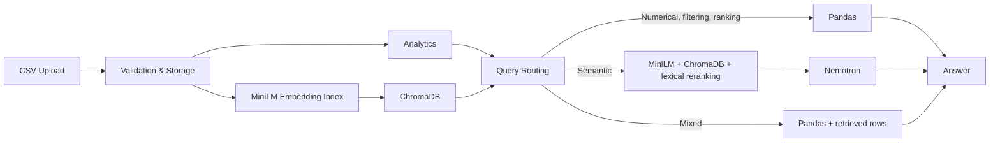

# RetailIQ — CSV Analytics & Hybrid RAG

RetailIQ lets users upload retail CSV datasets, explore analytics, and ask questions in natural language. Pandas performs exact calculations for numerical questions, while retrieval-augmented generation (RAG) finds relevant CSV records for descriptive questions and cites their source rows.

## Features

- Upload, validate, profile, and index CSV files up to 10 MB.
- Explore revenue, profit, orders, customers, and category or regional charts.
- Ask numerical, filtering, ranking, semantic, and mixed questions.
- Run exact aggregations and filters with Pandas instead of an LLM.
- Combine MiniLM vector similarity with keyword matching and 70/30 reranking.
- Generate grounded OpenRouter/Nemotron answers with original CSV row citations.
- Detect dataset currency, format monetary values, and inspect saved evaluation results.

## Tech Stack

| Area | Technologies |
| --- | --- |
| Frontend | React 19, Vite 8, Tailwind CSS 4, Plotly, react-markdown |
| Backend | Python 3.10, FastAPI, Pandas, Uvicorn |
| Database | PostgreSQL / Neon for upload metadata |
| Embeddings / RAG | MiniLM-L6-v2, sentence-transformers, ChromaDB, lexical reranking |
| LLM | OpenRouter with Nemotron |
| Testing | pytest, Node test runner, Oxlint, Vite production build |

## How It Works



Example routes:

- **Numerical:** “What is the total sales in the West region?” → Pandas.
- **Semantic:** “Find products whose names mention batteries.” → hybrid retrieval, then Nemotron.
- **Mixed:** “Summarize delayed Standard Class orders in California.” → Pandas filters plus relevant rows.

Uploads are stored locally, while PostgreSQL records their metadata and indexing status. Each source row becomes a searchable document with its upload ID and original row number preserved for citations.

## Evaluation

The optimized frozen C8 semantic benchmark contains five questions and uses the same labels and top-K settings as its baseline.

| Metric | Optimized result |
| --- | ---: |
| Precision@5 | 100% |
| Recall@5 | 18.16% |
| MRR@5 | 100% |

These results apply only to this five-question benchmark and do not represent every possible dataset or query. Separate checks recorded 100% post-fix accuracy across the C8 numerical, filtering, ranking, and mixed categories, while a five-query live evaluation completed successfully with one real Nemotron call.

## Run Locally

Prerequisites: Python 3.10+, Node.js with npm, a PostgreSQL database, and an OpenRouter key for semantic answers.

1. Clone the repository and enter it:

```bash
git clone https://github.com/WhyAvya/RetailIQ.git
cd RetailIQ
```

2. Create and activate a Python virtual environment:

```bash
python -m venv venv
source venv/bin/activate
```

On Windows PowerShell, activate it with `./venv/Scripts/Activate.ps1`.

3. Install backend dependencies:

```bash
python -m pip install -r backend/requirements.txt
```

4. Create a `.env` file in the project root:

```dotenv
DATABASE_URL=postgresql://<user>:<password>@<pooled-host>/<database>
DATABASE_URL_UNPOOLED=postgresql://<user>:<password>@<direct-host>/<database>
OPENROUTER_API_KEY=<your-openrouter-api-key>
OPENROUTER_MODEL=nvidia/nemotron-3-ultra-550b-a55b:free
```

`DATABASE_URL_UNPOOLED` is optional; when omitted, schema setup uses `DATABASE_URL`.

5. Start FastAPI from the project root:

```bash
python -m uvicorn backend.main:app --reload
```

6. In another terminal, install and start the frontend:

```bash
cd frontend
npm install
npm run dev
```

Open `http://localhost:5173`. The frontend uses `http://localhost:8000` by default; set `VITE_API_BASE_URL` when the backend runs elsewhere.

## Project Structure

```text
RetailIQ/
├── backend/                 FastAPI, analytics, indexing, and RAG
│   └── main.py              API entry point
├── frontend/                React application
│   └── src/App.jsx          Frontend entry component
├── evaluation/              Benchmarks, runners, and saved reports
├── tests/                   Backend regression tests
├── data/                    Sample Superstore CSV
└── backend/requirements.txt Python dependencies
```

## Testing

The latest repository audit recorded **270 backend tests passed**, **19 frontend tests passed**, and a successful frontend production build.

```bash
python -m pytest
cd frontend
npm test
npm run build
```

## Current Limitations

- Analytics and query planning target retail-style schemas rather than arbitrary CSV analytics.
- Uploaded CSV files and the ChromaDB index are currently stored on the local filesystem.
- In-process background indexing is not restart-safe; interrupted jobs require retrying.
- Public deployment requires authentication, dataset ownership controls, durable storage, and production environment configuration.
